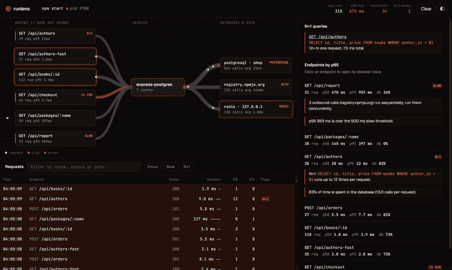
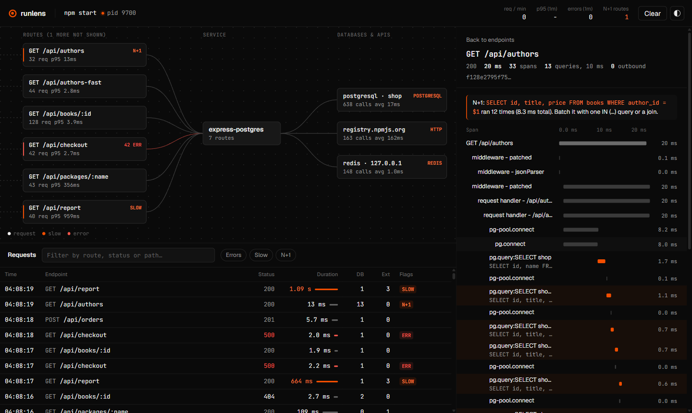
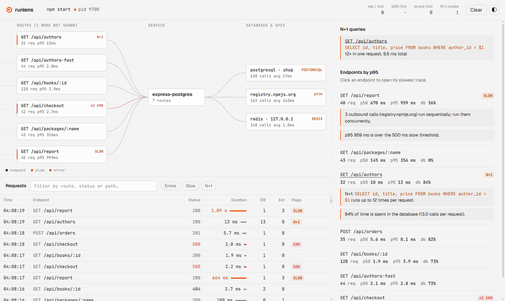

# runlens

See what your dev server actually does: live traces, a service map, N+1 queries and an MCP server for your coding agent. One command, no code changes.

[](https://github.com/Abdalkaderdev/runlens/actions/workflows/ci.yml)
[](https://pkg.go.dev/github.com/Abdalkaderdev/runlens)
[](LICENSE)

```sh
runlens npm run dev
```



## Why

Your app runs fine on your laptop, and that's where the slow paths hide. A list endpoint fires one query per row. A report calls three APIs one after another. A handler throws, but only on one route. You find out from production metrics, or you sprinkle `console.log` and guess.

Coding agents have it worse. They read your code but never see it run.

runlens puts OpenTelemetry in front of the dev command you already use, keeps the traces in memory, and shows them to you in a browser and to your agent over MCP. Nothing is added to your project.

## Features

- **Zero config.** `runlens <your dev command>` injects auto-instrumentation for Node and Python and opens the UI.
- **Live service map.** Routes, your service, databases and external APIs. Each request flows through as particles; edges thicken with throughput, errors turn red, slow requests are orange.
- **Request list and waterfall.** Method, route, status and duration for every request. Click one for every span, every SQL statement, outbound calls, and errors with stack traces.
- **N+1 detection.** The same query shape 5+ times in one request is flagged with the statement and count.
- **Hints.** Slow queries, database-bound endpoints, outbound calls that could run concurrently, p95 over budget.
- **Redacted by default.** SQL literals, DB parameters, auth headers and query-string values are scrubbed before storage.
- **MCP server.** `list_requests`, `get_trace`, `slowest_endpoints`, `find_n_plus_one`, `errors_since` and `service_map` over streamable HTTP or stdio.
- **Any OTLP source.** Already exporting OpenTelemetry? Point it at runlens. OTLP/HTTP (protobuf and JSON) and OTLP/gRPC.
- **One binary.** Go, UI embedded, loopback only, no database.

## Quick start

Install (Go 1.26+):

```sh
go install github.com/Abdalkaderdev/runlens@latest
```

Run your dev server through it:

```sh
runlens npm run dev
runlens node server.js
runlens python app.py
runlens uvicorn main:app --reload
```

The UI opens at `http://127.0.0.1:4318`. The first run for each runtime installs the OpenTelemetry packages into your user cache, which takes 10 to 60 seconds. Later runs start immediately.

Already emitting OTLP, or using another language? Start runlens on its own and point your exporter at it:

```sh
runlens
OTEL_EXPORTER_OTLP_ENDPOINT=http://127.0.0.1:4318 OTEL_EXPORTER_OTLP_PROTOCOL=http/protobuf ./your-app
```

### Try the examples

```sh
cd examples/express-postgres
docker compose up -d && npm install
runlens npm start              # app on :3100
node load.js 60                # in another terminal
```

```sh
cd examples/fastapi-sqlite
uv sync
runlens uv run uvicorn main:app --port 8100
curl localhost:8100/products   # N+1 over reviews
```

Both apps include a deliberate N+1 (`/api/authors`, `/products`), outbound calls, a slow endpoint and one that throws.

| Trace waterfall | Light theme |
| --- | --- |
|  |  |

## How it works

```
                 runlens (one Go binary, 127.0.0.1 only)
            ┌──────────────────────────────────────────────────┐
 your app   │  OTLP/HTTP  :4318/v1/traces ─┐                   │
 (child) ──►│  OTLP/gRPC  :4317 ───────────┼─► in-memory store │
            │                              │   (last N traces) │
            │                              ▼                   │
            │   analysis: N+1, p95, hints, service map         │
            │        │                │                │       │
            │   UI  :4318/        API :4318/api   MCP :4318/mcp│
            └────────┼────────────────┼────────────────┼───────┘
                  browser        SSE stream     Claude Code, Codex,
                                                Gemini CLI, Cursor
```

1. runlens detects the runtime from the command name.
2. **Node:** the child gets `NODE_OPTIONS=--import=<cache>/register.mjs`, which registers the ESM hook and loads `@opentelemetry/auto-instrumentations-node`.
3. **Python:** the child gets a `PYTHONPATH` entry with a `sitecustomize.py` that loads `opentelemetry-distro` from the cache. It runs your own `sitecustomize.py` first if you have one, and your packages always take precedence.
4. Spans are exported every 200 ms to runlens, stored in memory, analysed on read, and pushed to the UI over Server-Sent Events.

More detail in [docs/design.md](docs/design.md).

## Supported runtimes and libraries

Verified end to end on Windows 11 with the example apps and the test suite:

| Runtime | Version | Verified |
| --- | --- | --- |
| Node.js | 24 | Express 5 routes, `pg` 8 (Postgres), `ioredis` (Redis), global `fetch` |
| Python | 3.13, 3.14 | FastAPI 0.142 on uvicorn, `sqlite3`, `httpx` |
| Any OTLP exporter | | OTLP/HTTP protobuf, OTLP/HTTP JSON, OTLP/gRPC (receiver tests) |

The Node side ships every instrumentation in `@opentelemetry/auto-instrumentations-node` (MySQL, MongoDB, Fastify, Koa, gRPC, ...). The Python side installs instrumentations for Flask, Django, Starlette, requests, urllib3, aiohttp, psycopg, psycopg2, asyncpg, PyMySQL, SQLAlchemy, Redis and PyMongo. These are installed but not yet verified by this project; reports welcome.

## Use it from your coding agent

runlens serves MCP two ways:

- **Streamable HTTP** at `http://127.0.0.1:4318/mcp` while runlens is running.
- **stdio** with `runlens mcp`, which reads from the most recently started runlens (or `--url`).

Tools:

| Tool | Returns |
| --- | --- |
| `list_requests` | Recent requests with status, duration, DB and outbound counts. Filters: `endpoint`, `errors_only`, `min_duration_ms`, `limit`. |
| `get_trace` | Span tree for one trace: offsets, durations, SQL, peers, errors with stacks, N+1 findings, hints. |
| `slowest_endpoints` | Endpoints by p95 with p50, max, error count, DB share and hints. |
| `find_n_plus_one` | Repeated query shapes per endpoint with worst count and an example trace. |
| `errors_since` | Exceptions, error spans and 5xx in a window (`since`: `10m` or RFC3339). |
| `service_map` | Endpoint to database and external host edges with call counts and latency. |

### Claude Code

```sh
claude mcp add --transport http --scope project runlens http://127.0.0.1:4318/mcp
# or stdio
claude mcp add --scope project runlens -- runlens mcp
```

### Codex CLI

```sh
codex mcp add runlens -- runlens mcp
```

or in `~/.codex/config.toml`:

```toml
[mcp_servers.runlens]
url = "http://127.0.0.1:4318/mcp"
```

### Gemini CLI

```sh
gemini mcp add --transport http runlens http://127.0.0.1:4318/mcp
```

or in `.gemini/settings.json`:

```json
{ "mcpServers": { "runlens": { "httpUrl": "http://127.0.0.1:4318/mcp" } } }
```

### Cursor

`.cursor/mcp.json`:

```json
{ "mcpServers": { "runlens": { "url": "http://127.0.0.1:4318/mcp" } } }
```

Any other client: use `runlens mcp` as a stdio command.

Both transports were checked with headless Claude Code (`claude -p --mcp-config ...`) against the example apps. The Codex, Gemini CLI and Cursor snippets follow their current docs.

Then ask things like "which endpoint has an N+1 and what's the query?" or "why is /api/report slow?".

## Configuration

Flags go before the command: `runlens --slow 300ms npm run dev`.

| Flag | Default | |
| --- | --- | --- |
| `--port` | `4318` | UI, API, MCP and OTLP/HTTP. Falls back to a free port if taken. |
| `--grpc-port` | `4317` | OTLP/gRPC. `0` disables it. |
| `--no-open` | `false` | Don't open the browser. Also skipped when `CI` is set. |
| `--show-values` | `false` | Keep SQL literals, query strings and auth headers. |
| `--slow` | `500ms` | Requests slower than this are flagged. |
| `--slow-query` | `100ms` | DB and outbound spans slower than this are flagged. |
| `--n1` | `5` | Same query shape this many times in one request counts as N+1. |
| `--capacity` | `2000` | Traces kept in memory. |
| `--runtime` | `auto` | `node`, `python` or `none` to override detection. |
| `--service` | directory name | `OTEL_SERVICE_NAME` for the child, unless already set. |

Your own `OTEL_*` variables are respected, except the exporter endpoint, protocol and traces exporter, which runlens sets.

## FAQ and troubleshooting

**Nothing shows up.** Check the terminal for `runlens: ...` lines. Requests appear once the root HTTP span finishes; background work without an inbound request is stored but not listed. Run with `OTEL_LOG_LEVEL=debug` (Node) to see exporter errors.

**My command wasn't detected.** Force it: `runlens --runtime node make dev`.

**The first run is slow.** It installs the instrumentation packages once into your user cache (`%LocalAppData%\runlens` on Windows, `~/Library/Caches/runlens` on macOS, `~/.cache/runlens` on Linux). Delete that folder to reinstall.

**Python spans show 0 ms on Windows.** Python before 3.13 uses a coarse clock on Windows. Use 3.13 or newer.

**`conn.execute()` on sqlite3 isn't traced in my own setup.** runlens patches the DB-API proxy so it is. If you run `opentelemetry-instrument` yourself, use `cursor().execute()`.

**Port 4318 is taken.** runlens picks a free port and prints it. `runlens mcp` follows the most recent instance; pass `--url` to pick another.

**Is anything sent off my machine?** No. runlens listens on 127.0.0.1, rejects non-loopback `Host` headers and cross-site browser requests, and keeps data in memory only.

**Does it work with Bun or Deno?** Not injected. Configure their OTLP exporters to `http://127.0.0.1:4318`.

## Roadmap

- Request replay: re-send a captured request against your changed code and diff the traces.
- Optional SQLite persistence across restarts.
- Go, Ruby, Java and .NET injection.
- Log correlation per trace.
- Trace diff between two requests to the same endpoint.

## Contributing

```sh
cd ui && npm install && npm run build   # writes internal/ui/dist
go test ./...
go build -o runlens .
```

For UI work run `npm run dev` in `ui/` against a running runlens (the dev server proxies `/api` and `/mcp` to `127.0.0.1:4318`, or `RUNLENS_URL`). Commit the rebuilt `internal/ui/dist`; CI checks it is current. Keep PRs small, use conventional commit messages, and add a test for any analysis change.

## License

[MIT](LICENSE)

## Author

Abdalkader Alhamoud ([abdalkader.dev](https://abdalkader.dev), [GitHub @Abdalkaderdev](https://github.com/Abdalkaderdev))
